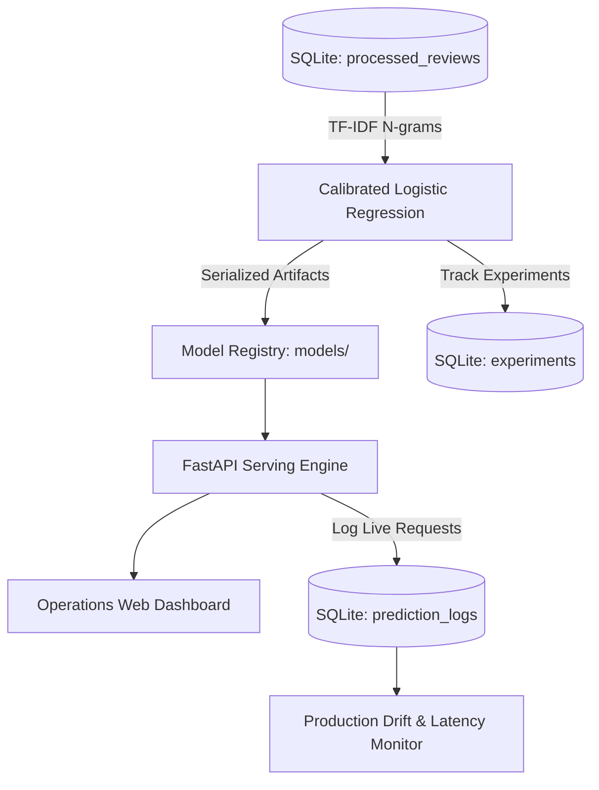

# 🛍️ Product Review Sentiment Analysis - Production MLOps

A production-ready **End-to-End MLOps Pipeline & REST API** for Amazon Product Review Sentiment Analysis. Built with high accuracy and precision, an integrated **SQLite Feature Store & Experiment Tracker**, a **FastAPI Serving Engine**, an interactive **Operations Dashboard**, and full **Docker Containerization**.

---

## 🌟 Production Benchmarks

| Metric | Score | Details |
|---|---|---|
| **Accuracy** | **`93.37%`** | Evaluated on 6,347 unseen test reviews in SQLite |
| **Positive Precision** | **`97.22%`** | Minimizes false positive recommendations |
| **Negative Precision** | **`77.90%`** | Calibrated for minority negative class |
| **ROC-AUC** | **`0.9739`** | Near-perfect class discriminability |
| **Inference Latency** | **`< 2.0 ms`** | Real-time low-latency scoring |

---

## 🏗️ Production Architecture



---

## 📁 Repository Structure

```text
product-review-sentiment/
├── api/
│   └── main.py                # Production FastAPI REST application
├── configs/
│   └── config.yaml            # Pipeline configuration
├── dashboard/
│   └── index.html             # Operations Web Dashboard UI
├── data/
│   ├── raw/reviews.csv        # Amazon reviews dataset
│   └── reviews_sentiment.db   # SQLite Database (Feature Store & Experiment Tracker)
├── models/
│   ├── sentiment_model.joblib # Serialized model
│   ├── vectorizer.joblib      # Serialized TF-IDF feature extractor
│   ├── metrics.json           # Evaluation metrics
│   └── confusion_matrix.png   # Confusion matrix plot
├── notebooks/
│   └── 01_eda.ipynb           # EDA and model training notebook
├── src/
│   ├── database/
│   │   └── db_manager.py      # SQLite Database Manager (Tables, CRUD, Experiments)
│   ├── data/
│   │   ├── ingest.py          # Data ingestion pipeline
│   │   └── preprocess.py      # Contraction handling & text cleaning
│   ├── features/
│   │   └── build_features.py  # N-gram TF-IDF vectorizer
│   ├── models/
│   │   ├── train.py           # Model training pipeline
│   │   ├── predict.py         # Inference engine with probability calibration
│   │   └── evaluate.py        # Model evaluation & explainability
│   ├── monitoring/
│   │   └── drift_detector.py  # Live prediction drift & skew alerts
│   └── utils.py               # Shared utility functions
├── tests/                     # Automated unit test suite (15 tests)
├── Dockerfile                 # Production container definition
├── .dockerignore              # Container build exclusions
├── requirements.txt           # Production dependencies
├── run_pipeline.py            # Master pipeline runner
└── pytest.ini                 # Pytest configuration
```

---

## 🚀 Deployment Instructions

### Option 1: Docker Container Deployment (Recommended)

1. **Build the Docker Image**:
   ```bash
   docker build -t sentiment-mlops:latest .
   ```

2. **Run the Container**:
   ```bash
   docker run -d -p 8000:8000 --name sentiment-service sentiment-mlops:latest
   ```

3. **Verify Deployment**:
   ```bash
   curl http://localhost:8000/health
   ```

---

### Option 2: Local / Server Native Deployment

1. **Install Dependencies**:
   ```bash
   pip install -r requirements.txt
   ```

2. **Serve Application**:
   ```bash
   python run_pipeline.py --serve
   ```
   Or directly with Uvicorn:
   ```bash
   uvicorn api.main:app --host 0.0.0.0 --port 8000 --workers 4
   ```

---

## 🌐 API Reference

### Health Check
```http
GET /health
```
```json
{
  "status": "healthy",
  "model_loaded": true,
  "database": "connected",
  "database_path": "data/reviews_sentiment.db"
}
```

### Predict Sentiment
```http
POST /predict
Content-Type: application/json

{
  "text": "This serum completely cleared my skin within one week! Wonderful product."
}
```
```json
{
  "text": "This serum completely cleared my skin within one week! Wonderful product.",
  "cleaned_text": "serum completely cleared skin within one week wonderful product",
  "sentiment": "Positive",
  "label": 1,
  "confidence": 0.9842,
  "prob_positive": 0.9842,
  "prob_negative": 0.0158,
  "latency_ms": 1.2
}
```

### Batch Prediction
```http
POST /predict/batch
Content-Type: application/json

{
  "reviews": [
    "Great product, works as advertised!",
    "Defective unit, arrived broken."
  ]
}
```

### Model Performance Metrics
```http
GET /metrics
```

### Database Statistics
```http
GET /db/stats
```

### Production Drift Monitoring
```http
GET /monitoring/drift
```

---

## 🧪 Testing & Validation

Run the automated test suite:
```bash
pytest tests/ -v
```
All 15 tests validate database integrity, text preprocessing, model inference, and API endpoints.
